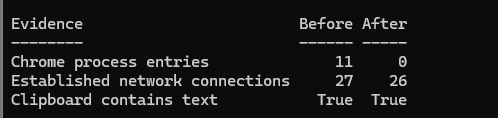
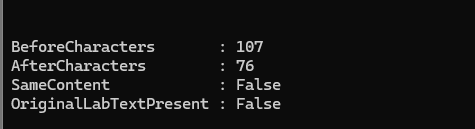
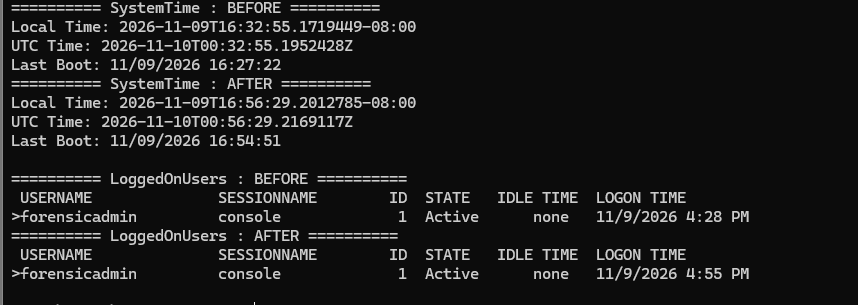
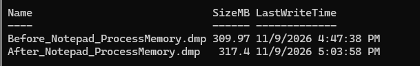

# Windows 11 Volatile Evidence & Registry Forensics

**Live-response comparison, process-memory acquisition, and Windows Registry change analysis in a controlled VM.**

> **Portfolio reconstruction of a November 9, 2026 lab.** Findings and screenshots come from my completed hands-on experiment. This independently written project is not an upload of my university submission, licensed instructions, complete memory dumps, or raw Registry inventories. The reusable helper scripts were authored separately afterward and are identified as such.

## Objective

Compare selected live Windows artifacts before shutdown and after restart, then investigate software installation evidence in Registry Uninstall entries. Interpret each observation within the limitations of its acquisition method.

## Environment

| Component | Configuration |
| --- | --- |
| Host | HP EliteBook 640 G9, Windows 11 Pro |
| Guest | Windows 11 Enterprise Evaluation, x64, build 26300 |
| Virtualization | Oracle VirtualBox 7.2.16 |
| Tools | PowerShell; `Get-CimInstance`; `query user`; `netstat -ano`; `Get-Process`; `net use`; `Get-Clipboard`; `Get-History`; `Get-ItemProperty`; `Compare-Object`; `Get-FileHash`; Task Manager |
| Scope | Synthetic browser and Notepad activity in a Windows 11 lab VM |

## Observed results

| Observation | Before | After | Interpretation |
| --- | ---: | ---: | --- |
| OS last boot (VM local time) | 4:27:22 p.m. | 4:54:51 p.m. | Different boot sessions |
| Interactive logon | 4:28 p.m. | 4:55 p.m. | New login |
| Chrome process entries | 11 | 0 | Chrome was not reopened for the second capture |
| Established TCP connections | 27 | 26 | Counts do **not** identify which individual connections persisted |
| Mapped network drives | 0 | 0 | No mappings shown by `net use` |
| PowerShell command-history entries | 7 | 6 | `Get-History` covers the current session only |
| Clipboard length | 107 characters | 76 characters | Collection-command copying may have overwritten the clipboard; shutdown causality **inconclusive** |
| Notepad process dump | 309.97 MB | 317.40 MB | Different process snapshots; no byte-level comparison |
| Installed-software Registry entries | 21 | 22 | One new Adobe Acrobat entry |

The comparisons are from this lab, not benchmarks of normal Windows behavior. See the [investigative findings](docs/findings.md) for detailed limitations.

## Screenshots from the experiment

Four relevant captures were selected from nine available screenshots. The bottom of the boot/logon image was cropped to remove an unrelated application, without changing the terminal evidence.

| Process/network snapshot | Clipboard comparison |
|:--|:--|
|  |  |
| The two totals changed, but no connection-level continuity was tested. | The collection process may have changed the clipboard itself. |

| Boot and login times | Notepad process dumps |
|:--|:--|
|  |  |
| A new boot and new interactive logon were recorded. | These are **process** dumps, not images of all physical RAM. |

## Registry finding

The original Uninstall Registry exports were reviewed: **21** rows before installing a PDF reader and **22** afterward. The separately recorded change CSV reports a single new item with `SideIndicator =>`:

- **Application:** Adobe Acrobat (64-bit)
- **Version:** `26.002.22031`
- **Publisher:** Adobe
- **Registry hive:** `HKEY_LOCAL_MACHINE`
- **InstallDate field:** `20261109`

`InstallDate` is a Registry value and **does not independently prove original installation time**. The private full inventories and unique Registry key path are not published. The verified, selected fields are in [the sanitized Registry delta](data/registry-change-sanitized.csv). No suitable Registry screenshot was available; this finding comes from the original CSVs and completed lab report.

## Evidence integrity and code

SHA-256 hashes of three original Registry evidence CSVs were recorded during the experiment. They appear in the [historical integrity record](docs/integrity-record.md). **These hashes are not hashes of the derived CSVs in this repository**, and cannot be independently checked without the withheld originals.

The `scripts/` directory contains **new post-lab utility examples**, not copies of the exact commands run on November 9:

- `compare_registry_exports.py` compares original-format installed-software CSVs. Tested against the reviewed original CSVs and with offline Python unit tests.
- `export-installed-software.ps1` illustrates enumerating three Uninstall Registry locations. **Not independently executed in the historical Windows VM in this refactored form.**
- `collect-volatile-snapshot.ps1` illustrates a limited live snapshot for an authorized Windows lab. **Not independently executed in the historical Windows VM in this refactored form.** No full RAM acquisition is performed.

Run the comparator against **synthetic example files** (not genuine lab evidence):

```powershell
python scripts/compare_registry_exports.py examples/registry-before-synthetic.csv examples/registry-after-synthetic.csv
```

Private evidence comparison (do not upload these original CSVs):

```powershell
python scripts/compare_registry_exports.py "C:\private\Before_InstalledSoftware.csv" "C:\private\After_InstalledSoftware.csv"
```

Run the cross-platform Python unit tests without third-party dependencies:

```powershell
python -m unittest discover -s tests -v
```

## Project layout

```text
.
├── README.md
├── .gitignore
├── .github/workflows/python-tests.yml
├── examples/ (synthetic CSVs for testing)
├── data/
│   ├── volatile-summary.csv
│   └── registry-change-sanitized.csv
├── docs/
│   ├── findings.md
│   ├── methodology.md
│   ├── integrity-record.md
│   └── evidence-register.csv
├── screenshots/
│   ├── 01_process_network_comparison.png
│   ├── 02_clipboard_comparison.png
│   ├── 03_boot_and_logon_times.png
│   ├── 04_notepad_dump_sizes.png
│   └── README.md
├── scripts/
│   ├── compare_registry_exports.py
│   ├── export-installed-software.ps1
│   └── collect-volatile-snapshot.ps1
└── tests/
    └── test_compare_registry_exports.py
```

## Limitations, provenance, and privacy

This was a controlled academic learning experiment, not a real incident or validated forensic benchmark. Collecting live evidence changes system state. A clipboard capture may itself overwrite the prior data. Process counts are not process identities; connection counts are not socket histories; Notepad dump sizes do not show which bytes differed. Registry metadata suggests application presence but is not conclusive proof of precise installation timing. This documentation is original portfolio writing based on learning in CYB/451 Computer Forensics Lab at the University of Phoenix. The submitted assignment and copyrighted course content are excluded. See [methodology and source handling](docs/methodology.md).

**Use on authorized systems only.** Keep raw clipboard, process, logon, network, and software inventory artifacts private and review all future screenshots before publication.